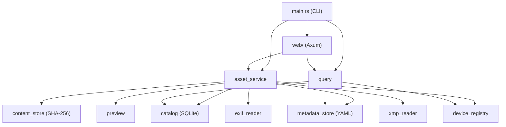

# Module Reference

This document describes the modules that make up the `maki` crate. All source code lives under `src/`.

## Module Dependency Graph



Additional modules not shown: `commands/` (the CLI handlers `main.rs` dispatches to), `config`, `models/`, `format`, `collection`, `saved_search`, `stack`, `embedded_xmp`, `tag_util`, `shell`, `error`, `tx`, `yaml_file`, `history`, `trash` and the other helper modules in the table below — used across layers.

## Module Table

| Module | File(s) | Purpose |
|------------|-------------------|-------------------------------------------------|
| `ai` | `src/ai.rs` | *(Pro, `ai` feature.)* Multi-model SigLIP wrapper with `ModelSpec` registry. Supports SigLIP ViT-B/16-256 (768-dim), SigLIP ViT-L/16-256 (1024-dim), and the multilingual SigLIP 2 base (768-dim) and large (1024-dim) variants. ONNX session management for vision and text encoders, image preprocessing (256×256 squash resize, normalize to [-1,1] CHW tensor), SentencePiece tokenization (pad to 64 tokens), sigmoid scoring (`logit_scale * dot + logit_bias`), and ~100 default photography labels. Provides `ModelSpec`, `get_model_spec()`, `SigLipModel` with `encode_image()`, `encode_texts()`, and `classify()`. |
| `ai_vocabulary` | `src/ai_vocabulary.rs` | *(Pro, `ai` feature.)* AI label vocabulary with optional hierarchical-tag mapping: the label list the SigLIP zero-shot classifier sees and the tag(s) applied when a label is picked. Loads `.yaml`/`.yml` vocabulary files (label → tag mapping) and `.txt` label lists (identity mapping). |
| `asset_service` | `src/asset_service.rs`, `src/asset_service/*.rs` | Orchestrates import, export, auto-tagging, face detection, VLM description, video metadata extraction, relocate, verify, sync, cleanup, dedup, refresh, the `fix-*` commands, and preview generation. Coordinates between content store, metadata store, catalog, EXIF/XMP readers, and preview generator. Shared workflow layer used by both CLI handlers and web routes to ensure identical behavior. `asset_service.rs` is the module root (types, the `AssetService` struct, constructors, free helpers); each concern is one `impl AssetService` block in a section file: `ai.rs`, `audio.rs`, `auto_stack.rs`, `cleanup.rs`, `dedup.rs`, `describe.rs`, `export.rs`, `fix.rs`, `import.rs`, `previews.rs`, `refresh.rs`, `relocate.rs`, `sync.rs`, `verify.rs`, `video.rs`, `volume.rs`, `watch.rs`, `workflow.rs` (plus the test-only `test_support.rs` with `ServiceEnv`). |
| `catalog` | `src/catalog.rs`, `src/catalog/*.rs` | SQLite database operations: schema creation, migrations, CRUD for assets/variants/recipes/locations, search queries with pagination and filtering, statistics, and tag management. `catalog.rs` is the module root (types, the `Catalog` struct, constructors, `with_tx`); each concern is one `impl Catalog` block in a section file: `schema.rs` (all DDL and the `migrate_vN` steps), `asset_crud.rs`, `variant_crud.rs`, `recipe_crud.rs`, `recipe_query.rs`, `lookup.rs`, `search_builder.rs`, `search_exec.rs`, `duplicates.rs`, `rebuild.rs`, `stats.rs`, `facets.rs`, `tags.rs`, `analytics.rs`, `backup.rs`, `cleanup.rs`, `volume.rs` (plus the test-only `test_support.rs`). `Catalog::open()` applies connection pragmas and registers the SQL helper functions only — it runs no migrations; `Catalog::open_fast()` is an alias of it (kept for the web server's connection pool). `Catalog::open_and_migrate()` (`maki migrate`) and `initialize()` (`init`, `rebuild-catalog`) are the calls that run schema migrations. |
| `cli_output` | `src/cli_output.rs` | CLI output helpers: `CliContext` (the `--json`/`--log`/verbosity flags, config and catalog root passed to every command handler), `ctx.emit()` for JSON-or-human output, human-readable formatting and common progress/status messages. |
| `collection` | `src/collection.rs` | Collection (static album) persistence. Dual storage: SQLite tables (`collections`, `collection_assets`) for fast queries, plus `collections.yaml` at catalog root for rebuild resilience. Provides `CollectionStore` with create, list, add/remove assets, and export/import operations. |
| `commands` | `src/commands/` | *(Binary only.)* Per-command CLI handlers, one `run_*_command` function per command, each taking the destructured clap fields plus a trailing `&CliContext`. `main.rs` parses and dispatches; the handlers are grouped by area: `ingest.rs`, `search.rs`, `tag.rs`, `organize.rs`, `maintain.rs`, `sync.rs`, `export.rs`, `status.rs`, `volume.rs`, `misc.rs`, `audio.rs`, and `ai.rs` / `faces.rs` for the AI commands. |
| `config` | `src/config.rs` | Parses and validates `maki.toml` configuration file. Defines `CatalogConfig` with sub-structs `PreviewConfig` (max_edge, format, quality), `ServeConfig` (port, bind), `ImportConfig` (exclude globs, auto_tags), and `AiConfig` (threshold, labels, model_dir, prompt). All sections are optional with sensible defaults. |
| `contact_sheet` | `src/contact_sheet.rs` | PDF contact-sheet generation: renders a grid of asset thumbnails with configurable layout, paper size and per-asset metadata fields (`[contact_sheet]` in `maki.toml`), using `printpdf`. |
| `content_store` | `src/content_store.rs` | SHA-256 content hashing for content-addressable storage. Provides `hash_file()` for computing file digests used as variant identity and integrity verification. |
| `embedding_store` | `src/embedding_store.rs` | *(Pro, `ai` feature.)* Dual persistence for image embeddings: SQLite table for queries + binary files for rebuild resilience. Provides `EmbeddingStore` with `store()`, `get()`, `find_similar()`, `has_embedding()`, `count()`, `remove()`, `list_models()`, and `all_embeddings_for_model()` — all scoped by model ID. `EmbeddingIndex` loads all embeddings for a model into a contiguous `Vec<f32>` buffer for fast in-memory similarity search (dot product with `BinaryHeap` min-heap for top-K). Index is cached in `AppState` and updated in-place when new embeddings are stored. Embeddings stored as little-endian f32 BLOBs in SQLite and as raw binary files under `embeddings/<model>/<prefix>/<asset_id>.bin`. Free functions: `write_embedding_binary()`, `delete_embedding_binary()`, `scan_embedding_binaries()`. Table: `embeddings(asset_id TEXT, embedding BLOB, model TEXT, PRIMARY KEY (asset_id, model))`, created by the schema migrations in `src/catalog/schema.rs`; `migrate_v13` also converts an old single-column-PK table. |
| `face` | `src/face.rs` | *(Pro, `ai` feature.)* Face detection and recognition pipeline using ONNX models. `FaceDetector` wraps YuNet (face detection with bounding boxes, landmarks, confidence) and ArcFace (512-dim recognition embeddings). Multi-stride output decoder handles YuNet models with 12 separate tensors at strides 8/16/32. Provides `detect_faces()` (returns `Vec<DetectedFace>` with normalized bboxes), `embed_face()` (112×112 aligned face → 512-dim L2-normalized vector), and the free function `save_face_crop()` (150×150 JPEG thumbnail). Model specs: `DETECTION_MODEL` (YuNet), `RECOGNITION_MODEL` (ArcFace), `FACE_MODEL_SPECS` (for listing/downloading). |
| `face_store` | `src/face_store.rs` | *(Pro, `ai` feature.)* Dual persistence for face detections and named people: SQLite tables for queries + YAML/binary files for rebuild resilience. Tables: `faces(id, asset_id, person_id, bbox_*, embedding, confidence, created_at, recognition_model)`, `people(id, name, representative_face_id, created_at)`. Files: `faces.yaml`, `people.yaml`, `embeddings/arcface/<prefix>/<face_id>.bin`. Provides `FaceStore` with `store_face()`, `faces_for_asset()`, `create_person()`, `name_person()`, `assign_face_to_person()`, `unassign_face()`, `merge_people()`, `delete_person()`, `auto_cluster()`, `list_people()`, `persist()` (writes `faces.yaml` and `people.yaml`), `export_all_faces()`, `export_all_people()`, `import_faces_from_yaml()`, `import_people_from_yaml()`, `import_face_embedding()`. Free functions: `write_arcface_binary()`, `delete_arcface_binary()`, `scan_arcface_binaries()`, `load_faces_yaml()`, `save_faces_yaml()`, `load_people_yaml()`, `save_people_yaml()`. Structs: `StoredFace`, `Person`, `AutoClusterResult`, `FaceRecord`, `PersonRecord`, `FacesFile`, `PeopleFile`. The denormalized `assets.face_count` column is maintained by `Catalog::update_face_count()` (`src/catalog/asset_crud.rs`). |
| `device_registry` | `src/device_registry.rs` | Volume registration and online detection. Manages the `volumes.yaml` file at the catalog root. Detects whether volumes are online by checking mount point existence. Provides `find_volume_for_path()` to auto-detect which volume contains a given file path. |
| `doctor` | `src/doctor.rs` | `maki doctor`: verifies, and optionally repairs, consistency between the YAML sidecars and the SQLite catalog by comparing every asset field by field in both directions; repair rebuilds the SQLite side of flagged assets from YAML. |
| `embedded_xmp` | `src/embedded_xmp.rs` | Extracts XMP metadata embedded in JPEG and TIFF binary data (APP1 marker for JPEG, IFD tag 700 for TIFF). Returns parsed XMP data for merging during import. Supported formats: `.jpg`/`.jpeg`/`.tif`/`.tiff`; all other extensions return empty immediately with zero I/O. |
| `embedded_xmp_write` | `src/embedded_xmp_write.rs` | Embedded XMP writer: splices an updated XMP packet into a JPEG's APP1 segment. Counterpart to the read-only `embedded_xmp`; used by `maki writeback --embed` *(Pro)*. The packet XML itself is edited by the writers in `xmp_reader`. |
| `error` | `src/error.rs` | Typed error model: `MakiError` (`NotFound`, `Offline`, `Conflict`, `InvalidInput`, `CheckFailed`) for outcomes callers act on, carried inside `anyhow`. `classify()` walks the context chain; `exit_code_for()` gives the CLI exit code and `http_status_for()` the web status. |
| `exif_reader` | `src/exif_reader.rs` | EXIF metadata extraction from image files using the `kamadak-exif` crate. Extracts camera make/model, lens, focal length, aperture, shutter speed, ISO, date/time, GPS coordinates, dimensions, and orientation. Provides `apply_exif_orientation()` for auto-rotating images based on EXIF orientation tags, and `apply_rotation()` for manual rotation overrides (used by preview generation). |
| `features` | `src/features.rs` | Compile-time feature facts in one place (`AI`, `PRO`, `edition()`), read by everything that reports the build: the edition suffix in `--version`/`--help`, the "AI available" flag in `status` and the web UI. |
| `format` | `src/format.rs` | Output format template engine for CLI commands. Supports preset formats (`ids`, `short`, `full`, `json`) and custom templates with `{placeholder}` substitution and escape sequences (`\t`, `\n`). Used by `search --format` and `duplicates --format`. |
| `history` | `src/history.rs` | Edit-history journal backing `maki undo` and `maki history`: one JSON file per metadata-edit operation under `<catalog>/history/`. A non-authoritative, prunable log — neither a sidecar nor part of `catalog.db`. Provides `HistoryStore`. |
| `model_manager` | `src/model_manager.rs` | *(Pro, `ai` feature.)* Download and cache management for SigLIP ONNX model files from HuggingFace. Model-aware: derives HuggingFace URL from `ModelSpec.hf_repo`. Downloads `vision_model_quantized.onnx`, `text_model_quantized.onnx`, and `tokenizer.json` via curl. Provides `ModelManager` with `ensure_model()`, `download_model()`, `remove_model()`, `list_files()`, `total_size()`, and `list_available_models()`. Default cache dir: `~/.maki/models/<model-id>/`. |
| `metadata_store` | `src/metadata_store.rs` | YAML sidecar file read/write operations. Sidecars are the source of truth for asset metadata. Stored at `metadata/<id-prefix>/<id>.yaml` within the catalog root. Handles serialization/deserialization of `Asset` structs with all nested variants, recipes, locations, and tags. |
| `models` | `src/models/` | Core data structures shared across all modules. Split into sub-modules: |
| | `src/models/mod.rs` | Re-exports and shared types (`Asset`, `FileLocation`) |
| | `src/models/asset.rs` | `Asset` struct: id, name, description, asset_type, tags, rating, color_label, created_at, variants. Includes `validate_color_label()` for the 7-color set. |
| | `src/models/variant.rs` | `Variant` struct: content_hash, original_filename, format, role, file_size, source_metadata, locations, recipes. Includes `best_preview_index()` / `best_preview_index_details()` for display variant selection, and `compute_best_variant_hash()` / `compute_primary_format()` for denormalized column computation. |
| | `src/models/recipe.rs` | `Recipe` struct: recipe_type, relative_path, volume_id, content_hash. Represents processing sidecars (XMP, COS, pp3, etc.) attached to variants. |
| | `src/models/volume.rs` | `Volume` struct: id, label, mount_point, is_online. |
| | `src/models/format.rs` | File-format vocabulary: extension groups and the pure classification helpers derived from them (`determine_asset_type()`, `is_raw_extension()`, `strip_media_extension()`, …) plus `normalize_rating()`. No I/O. |
| | `src/models/geo.rs` | Pure geographic helpers shared by the EXIF reader and `Variant` (GPS fallback from DMS display strings). |
| | `src/models/numeric_filter.rs` | `NumericFilter`, the one value type behind every numeric search filter (parsed in `query::parse`, rendered to SQL in the catalog). |
| `path_util` | `src/path_util.rs` | Path-string helpers shared by the storage and service layers; `forward_slashes()` is the one conversion from an OS path to the `/`-separated form used for catalog keys and sidecar paths. |
| `platform` | `src/platform.rs` | Platform openers (`open_path()`, `reveal_path()`, `open_terminal()`, `open_url()`): the one place that hands a path, directory or URL to the desktop (`open` / `xdg-open` / `cmd /c start`). |
| `preview` | `src/preview.rs` | Preview/thumbnail generation. Standard images use the `image` crate (resized to configurable max edge, default 800px). RAW files use `dcraw` or `dcraw_emu` (LibRaw). Videos use `ffmpeg`. Non-visual formats get info cards rendered with `imageproc`/`ab_glyph`. Previews stored at `previews/<hash-prefix>/<hash>.{jpg,webp}`. Smart previews (2560px) stored at `smart-previews/` with the same structure. |
| `query` | `src/query.rs`, `src/query/*.rs` | Search query parsing and `QueryEngine` orchestration. `query.rs` holds the request/result types, the `QueryEngine` struct and its constructors. `src/query/parse.rs` parses the filter syntax (`tag:X`, `rating:N+`, `label:Red`, `collection:X`, `path:prefix`, `orphan:true`, `missing:true`, `stale:N`, `volume:none`, `similar:<id>[:<limit>]`) into `ParsedSearch`, including path normalization for volume-relative prefix matching; `src/query/resolve.rs` resolves `collection:`, `person:` and `missing:` filters to asset-ID lists. `QueryEngine` wraps catalog + metadata store + device registry; its methods live in one `impl` block per concern: `search.rs` (`search`, `show`), `tags.rs` (`tag`, `tag_rename`, `tag_split`, `tag_delete`), `fields.rs` (`edit`, `set_rating`, `set_description`, `set_name`, `set_color_label`, `set_date`), `grouping.rs` (`group`, `split`, `auto_group`), `reimport.rs`, `context.rs` (mutation context, history recording), `writeback.rs` and `writeback_embed.rs` (XMP write-back). |
| `query_image` | `src/query_image.rs` | *(Pro, `ai` feature.)* Search by a query image that is not in the catalog, shared by `maki search --image` and the web `similar:@<token>` sessions: an exact-copy fast path by content hash, then an embedding search with the active SigLIP model. |
| `saved_search` | `src/saved_search.rs` | Saved search (smart album) persistence. Stores named queries in `searches.toml` at the catalog root. Provides `load()`, `save()`, and `SavedSearch` struct with `to_url_params()` for web UI chip rendering. |
| `session_root` | `src/session_root.rs` | Session-root rule ("which directory is the shoot"): `find_session_root()` for `auto-group` / `import --auto-group`, and the helpers behind the catalog's `session_root()` SQL function used by the `scattered:` filter. |
| `shell` | `src/shell.rs` | Interactive REPL for `maki shell`: wraps `rustyline` for line editing and dispatches typed lines through the same `clap` parser the binary uses. |
| `sidecars` | `src/sidecars.rs` | Creation of `.xmp` sidecar files for variants that have no XMP recipe yet; shared by `maki create-sidecars`, `maki relocate --create-sidecars` and the `[writeback] create_sidecars` auto-create path (naming rule, existing-sidecar checks, recipe registration). |
| `stack` | `src/stack.rs` | Stack (scene grouping) persistence. Dual storage: SQLite `stacks` table for fast queries + `stacks.yaml` at catalog root for rebuild resilience. Provides `StackStore` with create, add, remove, set_pick, dissolve, list, and export/import operations. Assets in a stack have `stack_id` and `stack_position` columns on the `assets` table. Position 0 is the pick (displayed in browse grid when stacks are collapsed). |
| `status` | `src/status.rs` | Aggregated catalog health report for `maki status`: combines cleanup dry-run, backup-status overview, schema version and embedding / face-scan coverage into one read-only `StatusReport`. |
| `tag_util` | `src/tag_util.rs` | Tag-string utilities: input normalisation (case, separator, NFC), ancestor expansion for hierarchical tags, leaf-tag counting (for `tagcount:`), and the marker prefixes (`=`, `/`, `^`, `\|`). |
| `test_support` | `src/test_support.rs` | *(Test-only.)* Crate-wide unit-test fixtures: `TempCatalog`, `memory_catalog()`, the `test_asset()` builder, `insert_rows()`, `test_variant()`. |
| `trash` | `src/trash.rs` | Trash / quarantine for destructive file operations: deleting commands move media and recipe files into `<catalog>/.trash/<date>/<volume>/<path>` instead of unlinking them; backs `maki trash list/restore/empty`. |
| `tx` | `src/tx.rs` | The one transaction primitive for the catalog connection, shared by `Catalog::with_tx` and the stores (`StackStore`, `CollectionStore`, `FaceStore`): commit on `Ok`, rollback on `Err`, nesting, and `export_at_commit()` so a store's YAML export is written once by the outermost transaction just before COMMIT. |
| `vlm` | `src/vlm.rs` | Ollama-compatible HTTP client for the VLM `describe` command *(Pro)*: sends image + prompt, parses the response into a description and tag list, applies per-model overrides from `[vlm.model_config."name"]`. |
| `vocabulary` | `src/vocabulary.rs` | Tag vocabulary file support: reads `vocabulary.yaml` from the catalog root and flattens the nested tree into pipe-separated tag paths, so autocomplete can offer planned tags that no asset uses yet. |
| `web` | `src/web/` | Axum web server. Split into sub-modules: |
| | `src/web/mod.rs` | Server setup, router construction, `AppState`, request logging middleware, graceful shutdown. |
| | `src/web/routes/` | All HTTP route handlers, one file per resource domain: `browse.rs`, `assets.rs`, `tags.rs`, `stats.rs`, `collections.rs`, `saved_search.rs`, `stacks.rs`, `calendar_map.rs`, `duplicates.rs`, `import.rs`, `maintain.rs`, `media.rs`, `volumes.rs`, `config.rs`, `jobs.rs`; `mod.rs` holds the helpers shared between them. `src/web/routes/ai/` (`ai` feature) adds `tags.rs`, `embed.rs`, `similarity.rs`, `query_image.rs`, `faces.rs`, `review.rs` and `stroll.rs` *(stroll page and neighbors API)*. Filter bar markup extracted into shared Askama includes (`filter_bar.html`, `filter_bar_js.html`). The L2 transitive neighbor feature (fan-out slider on the stroll page) is handled entirely in the frontend JavaScript within `templates/stroll.html`, reusing the existing `/api/stroll/neighbors` endpoint with chained requests — no additional backend route is needed. |
| | `src/web/jobs.rs` | Generic background-job registry (`JobRegistry`, `launch_job`) shared by the long-running web operations (import, embed, auto-tag, detect-faces, describe, …): job registration, per-item progress events over SSE, re-attach after a page reload, aggregate progress for the nav badge. |
| | `src/web/templates.rs` | Askama HTML templates and template helper structs (`BrowsePage`, `ResultsPartial`, `AssetPage`, `AssetCard`, `TagsPage`, `StatsPage`, `CollectionsPage`, `StrollPage`, `StrollCenter`, `StrollNeighbor`, and HTML fragment types for htmx partial updates). |
| | `src/web/static_assets.rs` | Compile-time embedded static files from `src/web/static/` served as in-memory responses: `htmx.min.js`, `style.css`, Leaflet and MarkerCluster scripts, stylesheets and marker images, `favicon.ico`, `maki-icon.svg`, and the browse page's script modules `browse/{batch,keyboard,facets}.js` (served at `/static/browse/{name}`). The stylesheet and the browse modules are linked with a content fingerprint (`?v=<12 hex digits of the SHA-256>`) and then cached as immutable. `maki-core.js` (shared front-end helpers under `MAKI.*`) is not served as a file; `base.html` embeds it inline. |
| | `src/web/tests.rs` | *(Test-only.)* In-process web harness: builds the real axum `Router` against a temporary catalog and drives it with `tower::ServiceExt::oneshot`. |
| `xmp_reader` | `src/xmp_reader.rs` | XMP sidecar parsing and write-back. Reads XMP files to extract `dc:subject` (tags), `dc:description`, `xmp:Rating`, `xmp:Label`, `dc:creator`, `dc:rights`. Write-back functions: `update_rating()`, `update_label()`, `update_tags()` (operation-level deltas), `update_description()`, `update_hierarchical_subjects()`. Handles XML escaping (`xml_escape` for writes, `xml_unescape` for reads — symmetric inverse pair so multi-pass writebacks don't accumulate `&amp;amp;…` escape layers; `&amp;` decoded LAST in unescape so nested encodings like `&amp;lt;` decode to `&lt;` not `<`), namespace-URI canonicalisation (any prefix bound to the Lightroom namespace — `lr:`, `lightroom:`, or exotic — collapses to one canonical `lr:hierarchicalSubject` block on write), namespace injection, and `rdf:Description` format conversion. The streaming reader uses `quick-xml`'s `Event::Text::unescape()` for entity decoding. The writers are locate-and-splice, not regex-based: one `quick-xml` pass yields byte-offset spans for the elements and attributes to change, and replacements are spliced into those spans; `<rdf:li>` values read on the way are unescaped with `xml_unescape` so the in-memory tag set stays in literal form (matches catalog), preventing the comparison-mismatch bug that drove the runaway-escape behaviour fixed in v4.5.17. |
| `yaml_file` | `src/yaml_file.rs` | Atomic persistence (`load_or_default()`, `save_atomic()`: temp file + rename) for the catalog-level YAML files (`stacks.yaml`, `collections.yaml`, `faces.yaml`, `people.yaml`, `volumes.yaml`, …). |

## Generated API Documentation

For detailed Rust API documentation with full type signatures, run:

```bash
cargo doc --no-deps --open
```

This generates HTML documentation from doc comments in the source code and opens it in your browser. The output is written to `target/doc/maki/`.
